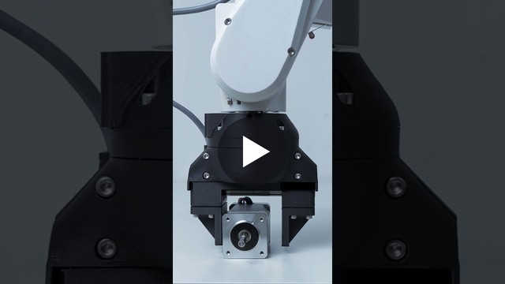

  

<h1 align="center">SSG-48</h1>

  <b>Open-source 3D-printed adaptive electric gripper.</b> 
  Every move sets where the jaws go, how fast, and how hard they press.

  <a href="https://source-robotics.com/products/compliant-gripper"><b>Buy</b></a>&nbsp;&nbsp;·&nbsp;&nbsp;
  <a href="https://docs.source-robotics.com/SSG48-gripper-docs/"><b>Documentation</b></a>&nbsp;&nbsp;·&nbsp;&nbsp;
  <a href="https://docs.source-robotics.com/SSG48-gripper-docs/latest/build/"><b>Build guide</b></a>&nbsp;&nbsp;·&nbsp;&nbsp;
  <a href="https://github.com/Source-Robotics/SSG-48-adaptive-electric-gripper/releases/latest"><b>Download</b></a>&nbsp;&nbsp;·&nbsp;&nbsp;
  <a href="https://discord.com/invite/prjUvjmGpZ"><b>Discord</b></a>

  
  
  

| **48 mm** | **8 to 80 N** | **180 mm/s** | **440 g** | **24 V, CAN** |
|:-:|:-:|:-:|:-:|:-:|
| stroke | grip force, set by the current | per jaw, at most | mass | on one M8 cable |

## Project overview

<table>
  <tr>
    <td width="55%" valign="middle">
      The SSG-48 adaptive electric gripper is a gripper based on
      <a href="https://source-robotics.com/products/spectral-micro-bldc-controller">Spectral Micro BLDC drivers</a>.
      It is a gripper capable of controlling its gripping force, making it perfect for assembly tasks and
      human-robot collaboration. The force can be adjusted from 8 N to 80 N, allowing you to grasp a wide range of
      items, from delicate and soft to rigid and sturdy.
        
      The mechanical files and the firmware are open source, allowing you to add a custom gripping tool and attach
      it to any robotic arm or robot. The gripper software is also open source. The gripper has a stroke of 48 mm
      and a mass of 440 g.
        
      <a href="https://www.youtube.com/shorts/DQgi8Ua-VAU"><b>&#9654;&#xFE0E;&nbsp; Watch the SSG-48 in action</b></a>
    </td>
    <td width="45%" valign="middle">
      
    </td>
  </tr>
</table>

## Start here

| I want to | Go to |
|---|---|
| **Buy an assembled gripper** | [source-robotics.com](https://source-robotics.com/products/compliant-gripper) |
| **Build my own** | [BOM](BOM/) · [print files](Gripper%20STL%20parts/) · [assembly manual](Assembly%20manual/) · [assembly video](https://www.youtube.com/watch?v=127zXHKuqIg) · [cables](Assembly%20manual/Building_cables.md) · [build guide](https://docs.source-robotics.com/SSG48-gripper-docs/latest/build/) |
| **Set it up and make it move** | [Quick start](https://docs.source-robotics.com/SSG48-gripper-docs/latest/quick-start/) · [Motor GUI](https://motorgui.com/), in the browser ([guide](https://docs.source-robotics.com/SSG48-gripper-docs/latest/05-setup/motor-gui/)) |
| **Program it** | [Python API](https://github.com/Source-Robotics/Spectral-BLDC-Python) ([first program](https://docs.source-robotics.com/SSG48-gripper-docs/latest/06-operation/python/#the-first-program)) · [ROS 2 package](https://github.com/Lass6230/ssg48_adaptive_electric_gripper_ros2) · [MSG gripper's ROS 2 package](https://github.com/BiomechatronicsLab/source_robotics_msg_gripper_ros2), which drives the SSG-48 too · [CAN and UART commands](https://docs.source-robotics.com/SSG48-gripper-docs/latest/reference/) |
| **Simulate it** | [URDF and MuJoCo models](ssg48_description/) |
| **Put it on a robot** | [PAROL6 and PAR6](https://docs.source-robotics.com/SSG48-gripper-docs/latest/06-operation/robots/) · [UR5 adapter plate](STEPS/UR5%20adapter%20plate/) · [PAROL6 gripper cable](https://source-robotics.com/products/gripper-cable) |

## In this repository

| Folder | What is in it |
|---|---|
| [`Gripper STL parts`](Gripper%20STL%20parts/) | every printed part of both hardware versions (`V1`, `V2`), and the coupler connectors for PAROL6, PAR6 and your own robot |
| [`gripper jaws`](gripper%20jaws/) | the fin-ray fingers and their jaw plate, STL and STEP |
| [`STEPS`](STEPS/) | the STEP files: the body parts, the whole gripper, the jaw plate template, the pinch jaws, the generic coupler connector and the UR5 adapter plate |
| [`BOM`](BOM/) | the bill of materials, with a shop link and a reference image for every part but the screws |
| [`Assembly manual`](Assembly%20manual/) | the assembly manual (PDF), the guide to building the cables and a motor datasheet |
| [`ssg48_description`](ssg48_description/) | the guide to the URDF and MuJoCo models, from [robot_descriptions](https://github.com/Source-Robotics/robot_descriptions) |

The [latest release](https://github.com/Source-Robotics/SSG-48-adaptive-electric-gripper/releases/latest) has the print
files, the STEP files, the jaws, the assembly manual and the BOM as ready downloads.

## Community

Ask in [Discussions](https://github.com/orgs/Source-Robotics/discussions), chat on
[Discord](https://discord.com/invite/prjUvjmGpZ), report a bug in
[Issues](https://github.com/Source-Robotics/SSG-48-adaptive-electric-gripper/issues), and follow Source Robotics:

## Safety, liability and disclaimer

This project includes experimental software, hardware designs, and assembly documentation that are still under development and may contain bugs, errors, or incomplete features. By using, building, or modifying this project, you acknowledge that:

* You use this project entirely at your own risk
* You are solely responsible for safe assembly, testing, and operation
* No guarantee is made regarding correctness, safety, or reliability
* The authors are not responsible for any damage, injury, or loss resulting from the use or misuse of this project
* Hardware performance and safety depend on user assembly, component quality, calibration, and handling, which cannot be guaranteed
* This project is provided “as is.” If you choose to build a device yourself using these files, designs, or instructions, you do so without any warranties or guarantees, including regarding safety, reliability, or suitability for any particular purpose.

> [!WARNING]
> THIS PROJECT INVOLVES LETHAL VOLTAGES AND OTHER SERIOUS HAZARDS THAT CAN CAUSE SEVERE INJURY. YOU MUST READ THE FULL [SAFETY WARNING AND DISCLAIMER DOCUMENT](SAFETY_WARNING_AND_DISCLAIMER.md)  BEFORE USING ANY PROJECT FILES. BY PROCEEDING, YOU ACKNOWLEDGE AND ACCEPT ALL RISKS AND AGREE TO USE THIS PROJECT ENTIRELY AT YOUR OWN RESPONSIBILITY.

## Licensing

Project is under the [CERN Open Hardware Licence Version 2 - Strongly Reciprocal](LICENSE) (CERN-OHL-S-2.0). Until 4 November 2026 it was under Apache-2.0.

## Versions

Which release and hardware version you have, and what works with it: [VERSIONS.md](VERSIONS.md).
