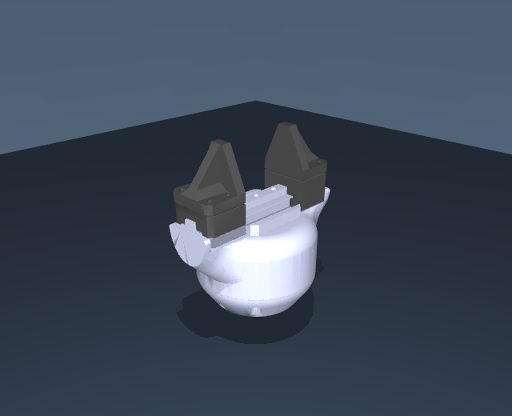
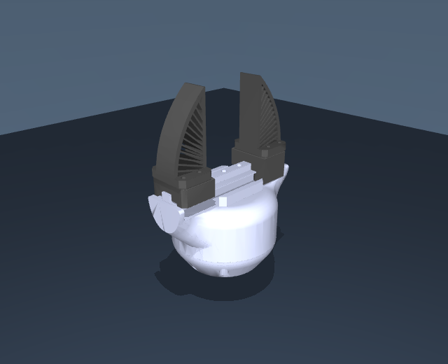

# SSG48 gripper: getting started

[All models](https://github.com/Source-Robotics/robot_descriptions/blob/8a0bf7f33972791534f652df8930671a8e851d97/README.md) | [PAR6](https://github.com/Source-Robotics/robot_descriptions/blob/8a0bf7f33972791534f652df8930671a8e851d97/guides/par6.md) | [PAROL6](https://github.com/Source-Robotics/robot_descriptions/blob/8a0bf7f33972791534f652df8930671a8e851d97/guides/parol6.md)

**Working with the gripper alone? Download a standalone package below.**
Both formats include **Solid jaws** (default) and **Fin-ray jaws**, with all meshes,
materials, finger joints, collision shapes and mass properties.

| Solid jaws (default) | Fin-ray jaws |
| --- | --- |
|  |  |

## 1. Download the gripper-only package

| Format | Download | Extracted folder |
| --- | --- | --- |
| MuJoCo | [Download ssg48_mujoco.zip](https://github.com/Source-Robotics/robot_descriptions/releases/latest/download/ssg48_mujoco.zip) | `ssg48/` |
| URDF | [Download ssg48_urdf.zip](https://github.com/Source-Robotics/robot_descriptions/releases/latest/download/ssg48_urdf.zip) | `ssg48_description/` |

These packages contain **only SSG48**, with a fixed mounting frame and two
moving fingers. No arm or grasp-test fixture is included. Keep the extracted
folder together so the model can find its meshes.

## 2. Choose jaws and open the model

| Jaws | MuJoCo viewer scene | URDF entry file |
| --- | --- | --- |
| Solid jaws (default) | [`scene_solid.xml`](https://github.com/Source-Robotics/robot_descriptions/blob/8a0bf7f33972791534f652df8930671a8e851d97/mujoco/ssg48/scene_solid.xml) | [`ssg48_solid.urdf`](https://github.com/Source-Robotics/robot_descriptions/blob/8a0bf7f33972791534f652df8930671a8e851d97/urdf/ssg48_description/ssg48_solid.urdf) |
| Fin-ray jaws | [`scene_fin_ray.xml`](https://github.com/Source-Robotics/robot_descriptions/blob/8a0bf7f33972791534f652df8930671a8e851d97/mujoco/ssg48/scene_fin_ray.xml) | [`ssg48_fin_ray.urdf`](https://github.com/Source-Robotics/robot_descriptions/blob/8a0bf7f33972791534f652df8930671a8e851d97/urdf/ssg48_description/ssg48_fin_ray.urdf) |

**MuJoCo:** from the directory where you extracted the download, run:

```bash
python -m mujoco.viewer --mjcf=ssg48/scene_solid.xml
```

Choose the other `scene_*.xml` to change jaws. `scene.xml` also opens Solid jaws.
The native gripper-only model files are `ssg48_solid.xml` and
`ssg48_fin_ray.xml`; the viewer scenes add lighting and a floor.

**URDF viewer:** load the selected `.urdf` from `ssg48_description/`, keeping
its `meshes/` folder alongside it. Upload the whole extracted package if a web
viewer requests a folder or ZIP.

**ROS 1 / RViz:** put `ssg48_description` in `catkin_ws/src`, build and source
your workspace, then run:

```bash
roslaunch ssg48_description display.launch jaws:=solid
```

Use `jaws:=fin_ray` for Fin-ray jaws. The supplied launch is ROS 1; ROS 2 can
consume the URDF using its own launch setup.

## 3. Move or attach the gripper

`flange` is the massless physical mounting frame. The gripper is fixed there
for standalone viewing; attach that frame to your robot for a mounted assembly.
The package does not add the robot's separate 55.5 g flange hardware.

In native MuJoCo, `gripper_actuator` accepts meters: **0 opens** and
**-0.0235 closes**. Each finger has 23.5 mm of commanded travel,
with the retained joint equality coupling. The URDF uses the same named finger
joints and its retained mimic relation; the consumer must implement mimic and
adjacent-body collision filtering. See the [package README](https://github.com/Source-Robotics/robot_descriptions/blob/8a0bf7f33972791534f652df8930671a8e851d97/mujoco/ssg48/README.md)
for endpoint and contact details.

The complete modeled mass is **440 g**, including two **39.3 g** moving
assemblies. Local COM/inertia and actuator settings retain their current
estimates. Selecting jaws changes visible/contact geometry; soft-material
deformation is not simulated. The existing `tcp` is a control frame rather
than a newly measured jaw-specific grasp center.

## Use SSG48 already mounted on PAR6 or PAROL6

Download the **robot** package using the [PAR6](https://github.com/Source-Robotics/robot_descriptions/blob/8a0bf7f33972791534f652df8930671a8e851d97/guides/par6.md) or [PAROL6](https://github.com/Source-Robotics/robot_descriptions/blob/8a0bf7f33972791534f652df8930671a8e851d97/guides/parol6.md)
guide, then choose the corresponding mounted entry:

| Jaws | Robot MuJoCo scene | Robot URDF file |
| --- | --- | --- |
| Solid jaws | `scene_ssg48.xml` | `par6_ssg48.urdf` / `parol6_ssg48.urdf` |
| Fin-ray jaws | `scene_ssg48_stock.xml` | `par6_ssg48_stock.urdf` / `parol6_ssg48_stock.urdf` |

## Source checkout and validation

In the SSG48 hardware repository, **`ssg48_description/`** contains this
product's guide and local previews. Download and extract the model ZIP into a
separate working directory or ROS workspace. The hardware guide folder is
documentation; the extracted URDF folder is the actual ROS/model package.

All maintained models live in the central `robot_descriptions` repository,
under `mujoco/ssg48` and `urdf/ssg48_description`. A software project
can load those paths from a pinned checkout if it needs local model sources.

[Standalone validation](https://github.com/Source-Robotics/robot_descriptions/blob/8a0bf7f33972791534f652df8930671a8e851d97/reports/standalone_grippers_validation.json) compares
tool-relative FK, local inertia, masses and controls with the mounted models,
then checks physical close/open behavior and relocated package assets.
[Migration instructions](https://github.com/Source-Robotics/robot_descriptions/blob/8a0bf7f33972791534f652df8930671a8e851d97/guides/legacy-models.md) cover the older standalone exports.

## Maintained model source

This folder contains the product guide and preview images. Download the runtime
model packages using the links above and extract them into your working directory.
All model files are maintained in [robot_descriptions](https://github.com/Source-Robotics/robot_descriptions);
this hardware repository has no model submodule to initialize.

Current tested model release: **[v2.14.0](https://github.com/Source-Robotics/robot_descriptions/releases/tag/v2.14.0)**.
See the [shared product guide](https://github.com/Source-Robotics/robot_descriptions/blob/8a0bf7f33972791534f652df8930671a8e851d97/guides/ssg48.md)
for the corresponding central documentation.
